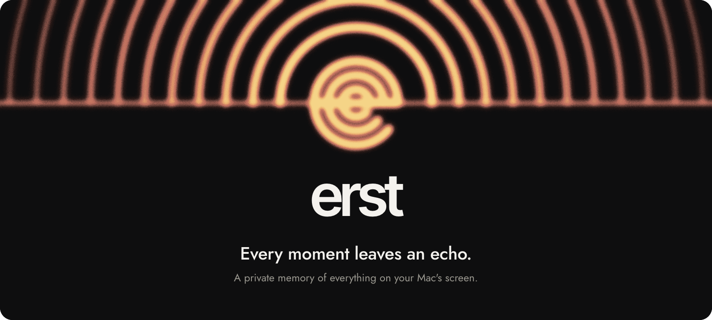
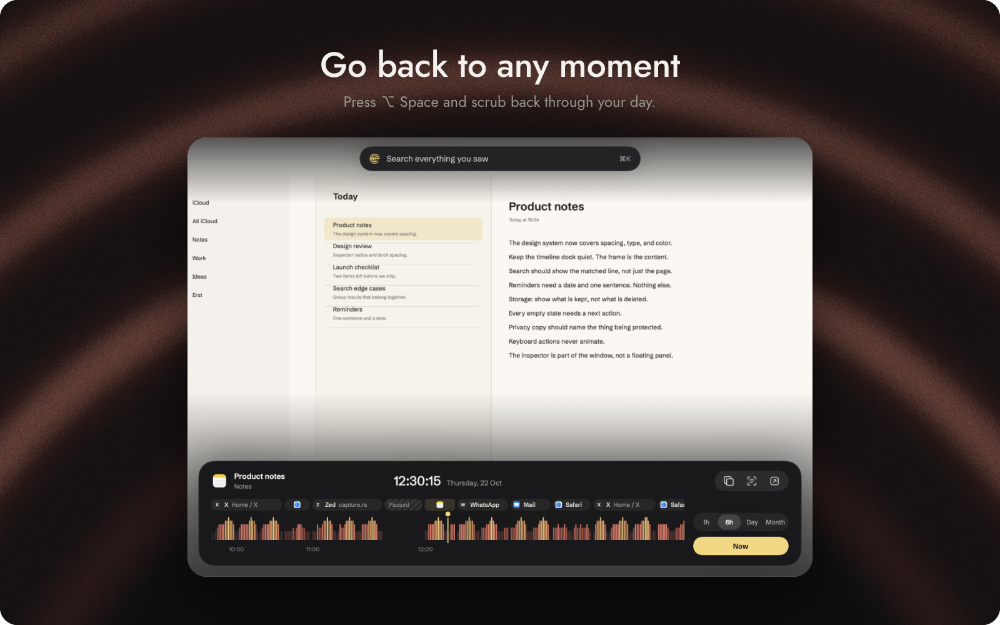
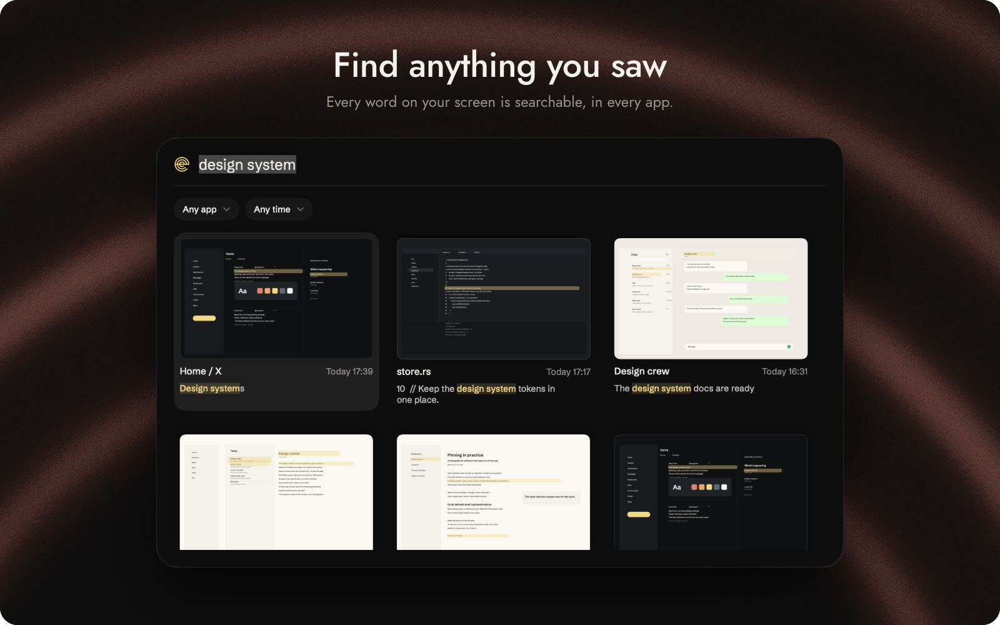
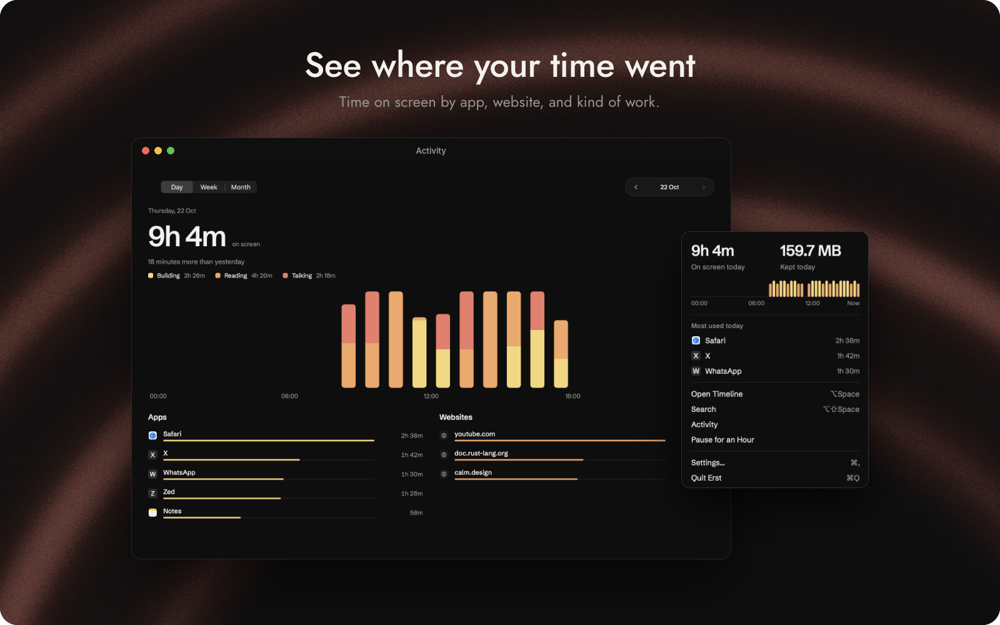
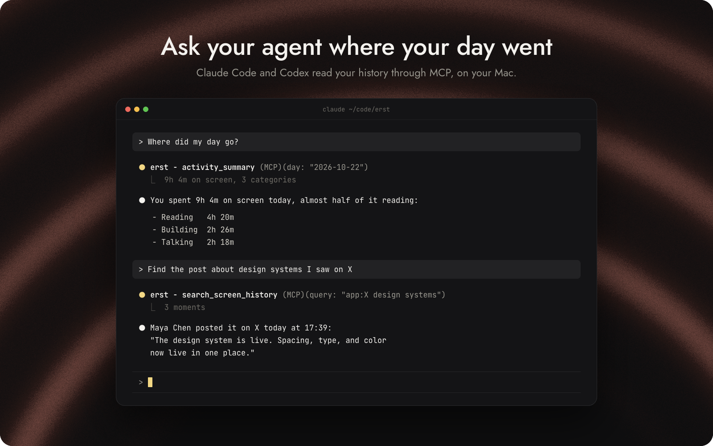
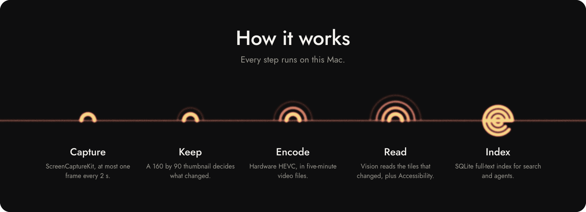

<p align="center">
  
</p>

<p align="center">
  <a href="../../releases/latest"><b>Download for macOS</b></a>
  &nbsp;&nbsp;&nbsp;&nbsp;
  <a href="#build-from-source">Build from source</a>
  &nbsp;&nbsp;&nbsp;&nbsp;
  <a href="docs/ARCHITECTURE.md">Architecture</a>
</p>

<p align="center">
  <sub>macOS 26 or later on Apple silicon. Free for personal use. Open source under AGPL-3.0.</sub>
</p>

<br>

Erst is a memory of your Mac's screen. It records what you see, keeps only the moments that changed, and reads the text on them. Scroll back to any moment, search any word you saw, see where your time went, and let your coding agent look things up for you. Everything stays in one folder on your Mac.

<br>

<p align="center"></p>

### Go back to any moment

Press <kbd>⌥</kbd> <kbd>Space</kbd> anywhere. The timeline opens on the latest moment, and the frame fills the panel.

- Scroll or drag the strip to move through the day. <kbd>←</kbd> and <kbd>→</kbd> step one moment, and with <kbd>⇧</kbd> they jump to the next app.
- The bars are heat: the taller and warmer a bar, the more the screen changed in the minute around it.
- Zoom from one hour to a whole month. **Now** brings you back to the present.
- Copy the text of a moment, open its page or file again, or set a reminder on it.

<br>

<p align="center"></p>

### Find anything you saw

Press <kbd>⌥</kbd> <kbd>⇧</kbd> <kbd>Space</kbd>, or <kbd>⌘</kbd> <kbd>K</kbd> inside the timeline. Search reads the text of every app, including the ones you never saved anything in: a chat, a terminal, a video caption, a page you closed.

- Results show the moment, the app, the window or page, and the matched line.
- Narrow by app and by time with the two filters under the field.
- Open a result to see the whole moment and its text, in reading order.

<br>

<p align="center"></p>

### See where your time went

Activity shows time on screen per day, week, and month, by app, by website, and by kind of work. Time comes from the app and page in front of you, not from the frames, so a quiet hour of reading still counts. The menu bar keeps today at a glance and pauses recording for an hour when you need it.

<br>

<p align="center"></p>

### Ask your agent

Open Settings, then Agents, and click Connect next to Claude Code, Codex, or Cursor. Erst adds its MCP server to the client's configuration, and for Claude Code and Codex it also links a skill that teaches the agent when to look something up and how to ask.

The server offers three tools. Results are text and metadata only; agents never receive images.

| Tool | Returns |
|---|---|
| `search_screen_history` | Moments that match a query, with time, app, window, URL, and the matched lines |
| `get_moment` | Every line of one moment, in reading order |
| `activity_summary` | One day's time on screen by category, app, and website |

Queries need every word in the same moment, and the last word also matches as a prefix. Use `"exact phrase"`, `app:Safari` or a bundle ID, `today`, `yesterday`, `since:2026-10-01`, and `until:2026-10-20`.

For any other MCP client, click Copy MCP config, or add this entry with the path to your copy of Erst:

```json
{
  "mcpServers": {
    "erst": {
      "command": "/Applications/Erst.app/Contents/Helpers/erst",
      "args": ["mcp"]
    }
  }
}
```

The same helper is a command-line tool. It opens the history read-only.

```sh
erst search invoice --limit 5      # matching moments, newest first
erst moment 4182                   # every line of one moment
erst activity --day 2026-10-22     # one day by category, app, and website
erst stats                         # how much Erst holds and since when
```

Add `--json` to any command for structured output. Settings, Agents, Terminal links `erst` into `/usr/local/bin`, and the same pane sets how far back agents may read.

<br>

<p align="center"></p>

### Your history stays on your Mac

- Erst has no account and no server. Your history lives in `~/Library/Application Support/Erst`.
- Password fields are never recorded. Apps you list in Settings, Privacy are never recorded, and 1Password is on that list from the start.
- Pause from the menu bar, or erase the last hour from Settings, Privacy. Erasing removes the frames, the text, and every video segment that overlaps the hour, with secure delete.
- Settings, Storage sets how long full-quality video stays, when the lighter copy takes over, and what remains after that.
- An agent you connect receives the results it asks for, and sends them to its own model provider. Settings, Agents limits how far back it can read.

Not in this version: the history is not encrypted, private browser windows are not skipped, and capture does not pause while you share your screen. These are on the [roadmap](docs/ROADMAP.md).

<br>

<p align="center"></p>

### How it works

- **Capture.** ScreenCaptureKit delivers at most one frame every two seconds.
- **Keep.** A 160 by 90 thumbnail of the frame is compared with the last kept one. Erst keeps the frame when enough changed, throttles continuous motion such as video, and keeps at least one frame every five minutes.
- **Encode.** Kept frames are appended to five-minute HEVC segments on the hardware encoder, at their real capture times.
- **Read.** Vision reads the text again only where 32 by 32 pixel tiles changed, so an unchanged line is never read twice. Accessibility adds the window title and the browser URL.
- **Index.** Each distinct line is stored once in SQLite with a full-text index. The timeline, search, activity, and agents all read from it.

Measured on an Apple M4 with the production settings:

| | Quiet use | Busy desktop |
|---|---|---|
| Disk per hour of use | 10.4 MB | 21.9 MB |
| CPU, average | 1.4% of one core | 3.6% of one core |

The method and the raw numbers are in [docs/MEASUREMENTS.md](docs/MEASUREMENTS.md).

The core is Rust and the app is Swift:

| Path | What it does |
|---|---|
| `crates/erst-core` | Change detection, the keep policy, retention, activity, heat, and query parsing. No I/O. |
| `crates/erst-store` | The SQLite schema, migrations, writes, and full-text search |
| `crates/erst-ffi` | The engine the app calls, through UniFFI |
| `crates/erst-cli` | The `erst` command and the MCP server, read-only |
| `app/Sources` | Capture, encoding, OCR, and every screen, in Swift and SwiftUI |

[docs/ARCHITECTURE.md](docs/ARCHITECTURE.md) is the contract between these modules.

<br>

## Install

1. Download `Erst.dmg` from the [latest release](../../releases/latest).
2. Drag Erst into Applications and open it.
3. Allow Screen Recording, so Erst can see the screen, and Accessibility, so it can read window titles and page addresses.
4. Press <kbd>⌥</kbd> <kbd>Space</kbd>.

Erst needs macOS 26 or later on Apple silicon.

## Build from source

You need macOS 26 or later on Apple silicon, Swift 6.2 from the Command Line Tools (Xcode is optional), and Rust stable through rustup.

```sh
scripts/dev-identity.sh   # once: keeps the Screen Recording permission across rebuilds
scripts/check.sh          # format, lint, Rust tests, and a build of every target
scripts/build-app.sh      # builds dist/Erst.app
scripts/run.sh            # opens Erst with .erst-dev data and streams its log
scripts/build-dmg.sh      # builds dist/Erst.dmg, the installer window
```

Read [CONTRIBUTING.md](CONTRIBUTING.md) before you open a pull request. The design rules are in [docs/DESIGN.md](docs/DESIGN.md) and the code rules in [docs/HYGIENE.md](docs/HYGIENE.md).

## License

Erst is open source under [AGPL-3.0](LICENSE), with a commercial license available. Personal use is free. If Erst helps you earn money, buy a license. See [docs/PRICING.md](docs/PRICING.md).
