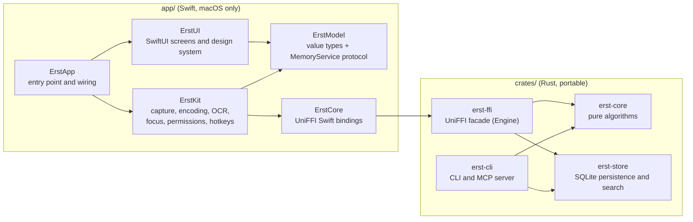

# Architecture

Erst is a local-first memory of everything you see on your screen. It records the screen, keeps only the frames that changed, reads the text on them, and lets you scroll back through time, search, and ask agents about it. Nothing leaves the machine.

This document is the contract between modules. If code and this document disagree, fix one of them in the same change.

## Layers



| Module | Owns | Must not |
|---|---|---|
| `erst-core` | Frame change detection, keep policy, retention planning, activity aggregation, heat buckets, query parsing | Do I/O, depend on SQLite or any platform API |
| `erst-store` | Schema, migrations, writes, reads, full-text search, storage stats | Contain policy decisions that belong to `erst-core` |
| `erst-ffi` | The `Engine` object exposed to Swift, mapping between FFI records and crate types | Contain business logic beyond mapping and orchestration |
| `erst-cli` | The `erst` binary: search, stats, export, `erst mcp` stdio server | Write to the database (it opens it read-only) |
| `ErstModel` | Swift value types, `MemoryService` and `AgentClientService` protocols | Import AppKit, SwiftUI, or ErstCore |
| `ErstUI` | Every screen and component, design tokens, fonts | Import ErstKit or ErstCore; it only talks to `MemoryService` |
| `ErstKit` | ScreenCaptureKit, AVAssetWriter, Vision, Accessibility, permissions, hotkeys, notifications, `LiveMemoryService` | Import SwiftUI views |
| `ErstApp` | `@main`, scenes, windows, panels, dependency wiring | Contain logic that fits in another module |

## Data flow of one frame

1. `CaptureService` receives a frame from `SCStream` at most once per `captureIntervalMs` (default 2000).
2. It downsamples the frame to a 160x90 luma thumbnail (the mean Rec. 709 luma of a 2x2-strided grid of each source block, read straight from the BGRA buffer) and calls `Engine.evaluateFrame`.
3. `erst-core` compares the thumbnail to the last kept one and returns `keep` and `changeRatio`. The first frame, a focus change, and `maxGapMs` (default 300000) without a keep always pass. A change of at least `majorRatio` is kept at once. A change between `keepRatio` and `majorRatio` is kept at most once per `minorGapMs` (default 20000). A run of major changes, each within `motionGapMs` of the previous major change whether it was kept or throttled, marks continuous motion and is throttled to one keep per `motionGapMs` (default 10000) until a pause longer than that gap passes without a major change. Quiet frames between majors carry the run forward.
4. Kept frames go to `SegmentWriter`, which appends them to the open HEVC segment (hardware encoder, quality 0.45 for Smaller and 0.6 for Faster, fragmented MP4, real capture timestamps as presentation times). The encoder settings are measured, not guessed: on six segments of a real 1440p day, re-encoded with the same frames and judged by luma SSIM and by the share of words Vision OCR still reads, `prio_speed` and spatial AQ change nothing, 10-bit Main10 costs about 8% more and the software encoder about 13% more at equal quality, AV1 with screen content tools (SVT-AV1 `scm=1`) is larger at this quality and would need a bundled encoder plus AV1 decoding hardware, one stream per app or per window saves under 2% because switches cost what really changed, and 94% of the video bytes belong to frames that brought at least five new lines of text. The lighter copy (half size, 0.45) is on the same frontier: at its size no other scale or quality keeps more words readable. Segments rotate every `segmentDurationMs` (default 300000) or when the frame size changes. `FrameReader` decodes single frames back from these files for Search thumbnails and the Timeline frame. Because an open segment is fragmented MP4 and keeps growing, a cached generator is valid only for the file size it loaded, and a failed read reloads it.
5. `TextRecognizer` runs Vision OCR on the kept frame and returns lines with normalized bounding boxes. `OCRQueue` schedules these requests:
   - Recognition uses the classic `VNRecognizeTextRequest` at the accurate level. The Swift `RecognizeTextRequest` took 12 to 32 seconds per frame on the development machine.
   - The first request in a process compiles Vision's models for 30 to 50 seconds. The app calls `TextRecognizer.warmUp()` at launch, before onboarding and recording. Later calls do not load again. They await the first load.
   - Until the models are ready, kept frames wait in a backlog of at most 96 MB of pixel buffers (`warmUpBacklogByteLimit`, six 2560x1440 frames). When a new frame would pass that limit, the oldest waiting frame is stored without text. A frame larger than the limit is stored without text at once. Once the models are ready, the backlog drains in capture order.
   - After warm-up, one recognition runs and one frame waits in a pending slot. A newer frame replaces the waiting frame, which is stored without text. A newer frame never cancels the running recognition.
   - A recognition that has not finished in 60 seconds is stuck inside Vision, which happened on macOS 27 with the Neural Engine read never returning. The queue stores that frame without text and pauses recognition: 5 minutes after the first stuck read of a run, twice as long after each later one, up to an hour. Frames that arrive or wait during a pause are stored without text. After 6 stuck reads in one run, Erst reads no more text until it restarts, because each stuck read keeps a thread and a frame copy for good. `Deadline` (ErstKit/System) runs the race; the stuck call keeps running on its own and its result is dropped. `TextRecognizer` runs Vision's blocking call on a GCD thread at the read's priority, so a stuck call never holds one of the few threads that Swift's tasks share. Launch Erst with `ERST_TEST_STUCK_TEXT_RECOGNITION=1` to make every read after the warm-up hang and hold its frame, which checks all of this in the real app.
   - Text recognition reads a copy of the kept frame (`CapturedFrame.owningCopy()`, at most 14.7 MB at the 2560-pixel capture width). `SCStream` lends only `queueDepth` (3) pixel buffers and silently stops delivering frames while all of them are held. On 2026-10-22 a stuck read held one lent buffer, the frame waiting behind it held another, and the encoder held the newest frame until the next one came, so recording stopped for 77 minutes. With the copy, the lent buffer goes back as soon as the encoder has appended it.
   - Closing a segment has the same kind of limit: `SegmentWriter` waits 20 seconds for `finishWriting`, then moves on to a new segment with what the file already holds. If a captured frame still waits on a step after 30 seconds, the recorder logs the step, because capture waits on each frame and a stall would otherwise be silent.
   - Reads run at background priority, on the efficiency cores: on the same 1440p frame they found the same 50 lines for 61 to 72 mJ instead of 319 to 336 mJ at utility priority, in about 230 ms instead of 75 ms. When the queue had to store a waiting frame without text, reads run at utility priority for the next 30 seconds, so a busy machine never costs a frame its text. The warm-up keeps utility priority.
   - Only what changed is read again. `TileSignature` fingerprints every 32 by 32 pixel tile of the frame (FNV-1a over the BGRA bytes, about 3,600 tiles at 1440p), so an unchanged tile holds exactly the bytes, and so the text, the last read frame held. `ReadPlan` joins the changed tiles into one region, grows each region over every old line it touches or reaches within 1.5 line heights sideways (so words typed at the end of a line reread the whole line and a phrase never splits), and reads it in one Vision call with a one-tile margin; each call has a fixed cost of about 20 ms, and on real use three or four separate regions (204 to 238 ms) cost more than one whole read (137 ms). New lines whose centers fall in a region replace the old lines that touch it; every other old line is kept. A frame that changed nowhere is not read at all, and a frame whose regions cover more than 90% of it, the first frame, a frame of another size, and the frame after a failed read are read whole. A video beside a page changes most of the screen but holds few lines, so it still reads as a region. Vision's cost follows the number of lines it reads, not the area (a region with 34 lines took 90 ms against 97 ms for the whole 54-line frame, an empty region about 20 ms), and separate calls per region were faster than one call with several requests (38 ms against 56 ms for three small regions). Two whole reads of the same unchanged line can differ ("of" against "off"), because Vision reads each line in the context of the whole frame, so `ErstProbe --verify` holds the incremental read to the frame's real text: it must find at least as many real words as the worse of the two whole reads around it and add no word a whole read would not. It reads a frame with an edited word, words typed at the end of a line, and a new line (2 regions, 36 of 38 real words, 41 to 45 ms against 69 to 85 ms whole), and a video beside a page (the video region alone, 24 of 29 real words, 24 to 39 ms against 59 to 69 ms whole). Reusing the old text for unchanged pixels also keeps a line's text stable from frame to frame, so it is stored once instead of once per reading.
6. `Engine.recordFrame` stores the frame row, its segment and presentation time, its focus metadata, and its text lines. Identical lines are stored once (see "Text deduplication").
7. `FocusTracker` reports app and window changes and idle periods as spans through `Engine.beginSpan` and `Engine.endSpan`. Activity reports come from spans, not frames, so skipped frames still count as time on screen.

### Accessibility text

Every kept frame also reads the exact text of the focused window through the Accessibility API, because Vision guesses at small text while the window's tree holds it. `AccessibilityTextReader` walks the focused window on its own serial queue, because every Accessibility call blocks until the target app answers or the messaging timeout passes. The read produces the same normalized top-left boxes, each line marked with source 1 and with whether its box is exact.

The walk reads each element with one `AXUIElementCopyMultipleAttributeValues` call: role, subrole, value, title, position, size, hidden flag, and children. `AXStaticText`, `AXTextField`, and `AXComboBox` contribute their value. `AXTextArea` contributes only its visible character range, split into at most 200 lines with one estimated box per line inside the visible frame. It contributes nothing when the app exposes no visible range, so OCR reads the area instead. `AXButton`, `AXLink`, `AXHeading`, `AXRadioButton`, `AXCheckBox`, `AXPopUpButton`, and `AXMenuButton` contribute their title only when they have no children, because their children carry the text otherwise. Their description is not read: it is the spoken label of an icon, such as "Back" or "Unnamed bookmark for x.com", not text on screen, and a visible label the tree only describes still reaches OCR. Text whose visible box is shorter than 4 points is dropped, because collapsed menus and hidden panels report such frames; on one real browser frame that was 223 of 418 lines. Every other role contributes no text but its children are still walked. An element and its subtree are skipped when it is a secure text field, when it is hidden, or when its frame does not intersect the window part on the display.

One read stops at 150 ms, 3000 nodes, depth 48, 2000 characters per line, or 200 text area lines. It keeps what it read and reports `truncated` when a limit stopped it, including a line cut at 2000 characters and a text area skipped because its two visible-range calls would pass the deadline. The messaging timeout for the app is 50 ms. Electron and Chromium apps build their tree only after `AXManualAccessibility` is set, so the reader sets it once per process; it never sets `AXEnhancedUserInterface`, which changes how some apps animate window moves.

`TextMerge` keeps every accessibility line, and each accessibility line carries whether its box is exact. A text area row and a line whose text was cut at 2000 characters have estimated boxes, because the tree does not know their real geometry, so they never hide OCR by position alone. An exact box drops an OCR line whose center falls inside it, with a 0.002 normalized tolerance so rounding at an element edge does not keep a duplicate, while an estimated box drops an OCR line only when the OCR line's matching key (the text lowercased, diacritics folded, letters and digits only, at least four characters) is contained in the estimated line's key. OCR remains for what the tree does not cover: other windows, images, canvases, and text an app does not expose. `RecorderMetrics` reports the accessibility reads, their total time, their lines, the truncated reads, and the OCR lines they replaced.

Privacy is the same as for the frame: the focused window only, on-screen elements only, never a secure text field, never an excluded app (the recorder checks `canKeep` before it starts a read), and never Erst's own windows.

## On-disk layout

```text
~/Library/Application Support/Erst/
  erst.sqlite            (+ -wal, -shm)
  segments/YYYY/MM/DD/HHmmss-<segmentId>.mp4
  logs/
```

There is no preallocated reserve file. All paths stored in the database are relative to the data directory.

## Database schema (erst-store)

SQLite through `rusqlite` with the `bundled` feature (SQLite 3.53.2). Pragmas on open: `journal_mode=WAL`, `synchronous=NORMAL`, `foreign_keys=ON`, `auto_vacuum=INCREMENTAL` (set before the first table is created), `journal_size_limit` of 4 MiB, one automatic checkpoint's worth (without it the WAL file stays as large as the largest transaction ever written), and `secure_delete=ON`, which zeroes erased cells in the database file. Migration 0002 also turns on FTS5 `secure-delete`, so erased terms do not survive in the full-text index. Migration 0003 adds the `pending_unlinks` queue and rebuilds `frame_lines` so identical text at different x positions stays separate. Migration 0004 adds `frame_lines.source`, the column that tells OCR text from accessibility text and from the window title; rows written before it read as OCR. Migration 0005 replaces `frame_lines` with packed `frame_text` layouts and `line_runs`; its Rust step (`pack_frame_lines` in `schema.rs`) copies the rows in the same transaction and drops the table. Migrations are embedded SQL files in `crates/erst-store/migrations/NNNN_name.sql`, each with an optional Rust step, applied in order and tracked with `PRAGMA user_version`. After a migration, an erase, or a segment delete, `release_free_pages` steps `PRAGMA incremental_vacuum` until it is done, because it frees one page per step and a single step would leave the rest of the freed space inside the file. After a migration the WAL is also truncated, since the migration wrote the whole database through it.

All timestamps are Unix milliseconds (`INTEGER`). Bounding boxes are integers in `0..=10000` (normalized to the frame, origin top-left).

```sql
CREATE TABLE apps (
  id        INTEGER PRIMARY KEY,
  bundle_id TEXT NOT NULL UNIQUE,
  name      TEXT NOT NULL
);

CREATE TABLE segments (
  id          INTEGER PRIMARY KEY,
  path        TEXT,                 -- NULL once the video was deleted by retention
  started_at  INTEGER NOT NULL,
  ended_at    INTEGER,              -- NULL while open
  width       INTEGER NOT NULL,
  height      INTEGER NOT NULL,
  bytes       INTEGER NOT NULL DEFAULT 0,
  tier        INTEGER NOT NULL DEFAULT 0  -- 0 full, 1 reduced, 2 text only
);

CREATE TABLE frames (
  id            INTEGER PRIMARY KEY,
  captured_at   INTEGER NOT NULL,
  segment_id    INTEGER NOT NULL REFERENCES segments(id),
  pts_ms        INTEGER NOT NULL,   -- presentation time inside the segment
  app_id        INTEGER REFERENCES apps(id),
  window_title  TEXT,
  url           TEXT,
  change_ratio  REAL NOT NULL
);
CREATE INDEX frames_captured_at ON frames(captured_at);

CREATE TABLE text_lines (
  id    INTEGER PRIMARY KEY,
  hash  BLOB NOT NULL UNIQUE,       -- 16-byte hash of the normalized text
  text  TEXT NOT NULL
);

CREATE TABLE frame_text (
  frame_id INTEGER PRIMARY KEY REFERENCES frames(id) ON DELETE CASCADE,
  layout   BLOB NOT NULL              -- packed placements, see Text deduplication
);

CREATE TABLE line_runs (
  line_id     INTEGER NOT NULL REFERENCES text_lines(id),
  first_frame INTEGER NOT NULL,       -- every frame with an id in first..=last shows the line
  last_frame  INTEGER NOT NULL,
  PRIMARY KEY (line_id, first_frame)
) WITHOUT ROWID;

CREATE VIRTUAL TABLE text_lines_fts USING fts5(
  text, content='text_lines', content_rowid='id',
  tokenize='unicode61 remove_diacritics 2', prefix='2 3'
);
-- plus the three standard triggers that keep text_lines_fts in sync with text_lines

CREATE TABLE spans (
  id           INTEGER PRIMARY KEY,
  app_id       INTEGER NOT NULL REFERENCES apps(id),
  window_title TEXT,
  url          TEXT,
  started_at   INTEGER NOT NULL,
  ended_at     INTEGER              -- NULL while open
);
CREATE INDEX spans_started_at ON spans(started_at);
CREATE INDEX spans_app_started ON spans(app_id, started_at);

-- Reserved for a later feature. Nothing reads or writes marks yet.
CREATE TABLE marks (
  id          INTEGER PRIMARY KEY,
  frame_id    INTEGER REFERENCES frames(id) ON DELETE SET NULL,
  created_at  INTEGER NOT NULL,
  note        TEXT
);

CREATE TABLE reminders (
  id          INTEGER PRIMARY KEY,
  frame_id    INTEGER REFERENCES frames(id) ON DELETE SET NULL,
  created_at  INTEGER NOT NULL,
  due_at      INTEGER NOT NULL,
  note        TEXT NOT NULL,
  done_at     INTEGER
);

CREATE TABLE excluded_apps (bundle_id TEXT PRIMARY KEY);

CREATE TABLE settings (key TEXT PRIMARY KEY, value TEXT NOT NULL);

-- Relative video files whose rows are gone but which still need unlinking.
CREATE TABLE pending_unlinks (path TEXT PRIMARY KEY);
```

### Text deduplication

Consecutive frames share most of their text. Each distinct line is stored once in `text_lines` (keyed by a hash of the normalized text: trimmed, inner whitespace collapsed, case preserved). Each frame stores where its lines sit in one packed blob in `frame_text`: a version byte, a varint count, then per placement, sorted top to bottom, five varints (`line_id << 2 | source`, `y` minus the previous `y`, `x`, `w`, `h`), about 10 bytes a line where a row plus a line index took about 41. The same line at the same spot twice is stored once. Search goes from a line to its frames through `line_runs`: a run says every frame with an id in `first_frame..=last_frame` shows the line. `insert_frame` extends a line's latest run when it ends at the frame just before the new one and starts a run otherwise; a frame without the line ends its run. New frames always take an id above every existing one, and erase pulls each run's ends in to frames that still exist and drops empty runs, so a reused id never lands inside an old run. Migration 5 packed the version 4 `frame_lines` rows the same way in under a second; on a real day of recording (2,895 frames, 456,394 placements) the database went from 26.2 MB to 14.5 MB with every frame's lines and every line's frames identical, and 300 real searches gave byte-identical results. Full-text search runs on unique lines and joins back to frames. `source` is 0 for OCR text, 1 for text read from the focused window's accessibility tree, and 2 for the frame's window title. `insert_frame` writes the title as one more line with a zero box at (0, 0), so a search finds a frame by the words in its title. Window titles are searchable lines with no box, and they are left out of a moment's text because the moment already shows its title from `frames.window_title`.

### Search results are moments, not frames

A query matches lines, which map to many frames. `search` groups consecutive matching frames of the same app and window into one hit when they are less than 10 minutes apart, and returns the frame with the most matched lines as the representative. Candidates are paged by `(captured_at DESC, id DESC)` until `limit` moments are formed or rows run out, so a long recent session cannot fill the window and hide an older matching moment. Results are ordered by recency unless the query asks for relevance.

### Search plans

`search` counts matched lines with a capped FTS5 query (`LINE_PLAN_MAX_MATCHED_LINES + 1`) and picks an access plan from that count, so plan choice never materializes a huge id list. Below `LINE_PLAN_MAX_MATCHED_LINES` (20,000) it uses the line-driven plan: follow each matched line's `line_runs` to its frames, deduplicate, and sort. At or above the threshold it uses the frame scan: walk frames newest first in bounded pages, check each page's few line ids against the matched set, and stop once enough moments are formed. The frame-scan page grows when a page has no match, so a sparse term still scans the same rows in fewer round trips. The full matched id list is loaded only after the plan is chosen, ordered by rowid; membership is a binary search. Matched-line counts for a page come from the page's packed layouts, read in one query and decoded in Rust, not one query per frame.

The threshold sits below the measured crossing and leaves headroom for slower machines. In `examples/bench_store.rs` over 1,000,000 lines: 4 matched lines cost about 0.07 ms line-driven and 310 ms frame-scan, 20,661 matches about 32 ms and 1.1 ms, and 79,385 matches about 89 ms and 2.9 ms. The benchmark writes those lines in the version 4 layout and lets migration 5 pack them, which takes about 1.4 s; `insert_frame` with 80 lines takes about 0.32 ms. Every automatic-plan case stays under the 50 ms budget. `search_with_plan` exposes both plans for the benchmark; production calls `search`.

### Timeline track

The Timeline is a frame-indexed scrubber: every kept frame takes the same width, and consecutive frames of the same app (and, for a browser, the same site) form one segment with the app icon at its start. The track draws chips by `TimelineTrack.chipRuns()` in ErstModel: neighbouring segments of one app share one chip, and a glance (an app on screen for less than `TimelineTrack.glanceSeconds`, 15, measured from its first frame to the next segment's first frame, since a switch of app always keeps a frame) joins its neighbours without crossing a session pause. The last segment is never a glance. A chip shows the app name and one detail line: its site `host` for a browser segment, else the segment's `title` cleaned by `ErstModel.WindowTitle.clean`, which drops a trailing separator and app name and answers nil when nothing else is left. A segment's `title` is the window title of its last frame, the one the user last saw there, trimmed; it is `None` when that frame had no title or only whitespace. A segment whose title changed mid-run therefore shows the newest one. Idle time takes no space, so a long pause only adds a visible gap. `Engine.timeline_track(start_ms, end_ms)` reads the frames of `[start_ms, end_ms)` with `track_frames`, which selects each frame's app, window title, URL, and change ratio in one `frames_captured_at` range seek, and groups them in `erst-core::track`. Each frame carries its `change_ratio`. The app turns it into a heat level per frame in `ErstModel.TrackHeat`: the weighted count of kept frames within 30 seconds of the frame, each weighing `min(1, change_ratio / 0.05)`, like the menu bar heat. A frame joins the current segment when its `SegmentKey { bundle_id, host }` matches the previous frame's and the pause since that frame is at most `SESSION_GAP_MS` (10 minutes); a longer pause starts a new segment and marks it `starts_session`. The `host` comes from the frame URL through `url_host`, which lowercases, strips the scheme, port, and leading `www.`, and answers `None` for a non-http URL. The capture layer reads a URL only from a browser window, so a stored URL is the evidence of a site and no browser list is repeated. `FfiTrackSegment` carries `bundle_id`, `app_name`, `title`, and `host`, so a chip needs no second read. A frame with no app gets bundle id `""` and app name `"Unknown"`, `frames[i].segment` indexes `segments`, and a segment's `first_frame` and `last_frame` index `frames`. A range that holds more than `MAX_TRACK_FRAMES` (200,000) frames is `InvalidInput` with a request for a shorter range, because the app loads a few days at a time. The scroll document is `contentWidth + viewport` wide; a 50,000-frame track at 24 points per frame (1,200,000 points) adds under 2 MB of resident memory from hosting through three scrolls, so it keeps that width instead of moving a content origin.

## Rust crates

### erst-core (pure, no I/O)

| Module | Public API (names are binding) |
|---|---|
| `diff` | `Thumbnail { width: u32, height: u32, luma: Vec<u8> }`, `KeepPolicy { tile_size: u32, tile_threshold: u8, keep_ratio: f32, major_ratio: f32, ignore_top_fraction: f32, max_gap_ms: i64, minor_gap_ms: i64, motion_gap_ms: i64, motion_run_keeps: u8 }` with `Default`, `KeepPolicy::decide(&self, previous: Option<&Thumbnail>, next: &Thumbnail, ctx: &FrameContext, state: KeepState) -> KeepDecision`, `FrameContext { now_ms: i64, last_kept_ms: Option<i64>, focus_changed: bool }`, `KeepState` (the major run and the time of the last major change, stored beside the last kept thumbnail), `KeepDecision { keep: bool, change_ratio: f32, reason: KeepReason, next_state: KeepState }`, `KeepReason { FirstFrame, FocusChanged, MaxGap, Changed, Unchanged, MajorChanged, MinorDeferred, MotionThrottled }` |
| `retention` | `RetentionPolicy { full_quality_ms: i64, reduced_ms: Option<i64>, budget_bytes: Option<u64>, after_lighter_copy: AfterLighterCopy }`, `AfterLighterCopy { KeepText, DeleteEverything }`, `SegmentInfo { id: i64, started_at: i64, bytes: u64, tier: Tier }`, `Tier { Full, Reduced, TextOnly }`, `plan(policy, segments, now_ms) -> Vec<RetentionAction>`, `RetentionAction { segment_id: i64, action: RetentionKind }`, `RetentionKind { Reduce, DeleteVideo, DeleteSegment }` |
| `activity` | `Span { bundle_id: String, url: Option<String>, started_at: i64, ended_at: i64 }`, `Category { Building, Reading, Talking, Other }`, `categorize(bundle_id, host) -> Category` (a known site decides first, then browsers count as reading, then a built-in app table), `BucketKind { Hour, Day }`, `summarize(spans, range: TimeRange, offset_ms_at) -> Result<ActivitySummary, CoreError>` with `total_ms`, per app, per website host, per category, `kind`, and `buckets: Vec<ActivityBucket>` where each bucket is `{ start_ms, end_ms, building_ms, reading_ms, talking_ms, other_ms }` |
| `heat` | `heat_buckets(stamps: &[(i64, f32)], range: TimeRange, buckets: usize) -> Result<Vec<u8>, CoreError>` returning levels `0..=5` (0 means no kept frame in the bucket); `hourly_heat(stamps, range, offset_ms_at) -> Result<Vec<DayHeat>, CoreError>` returning one `DayHeat { day, hours: [u8; 24] }` per local day the range touches, each stamp in the wall-clock hour it fell in (a fall-back day's repeated hour folds into one slot, a spring-forward day's skipped hour stays empty), levelled like `heat_buckets` against the busiest hour of the whole range so days compare |
| `query` | `parse(input: &str, now_ms: i64, offset_ms_at: impl Fn(i64) -> i64) -> ParsedQuery { terms: Vec<String>, phrases: Vec<String>, app: Option<String>, since_ms: Option<i64>, until_ms: Option<i64> }` supporting `app:Safari`, `app:"Visual Studio Code"`, `today`, `yesterday`, `since:2026-10-01`, `until:2026-10-20`, and quoted phrases; `ParsedQuery::fts_match(&self) -> Option<String>` builds a safe FTS5 MATCH expression |
| `time` | `TimeRange { start_ms: i64, end_ms: i64 }` (half-open), `now_ms() -> i64` (the only clock read in the crate), `local_day_containing(now_ms, offset_ms_at) -> TimeRange`, `local_day_of_text(text, offset_ms_at) -> Option<TimeRange>` for `YYYY-MM-DD`, `local_day_count(range, offset_ms_at) -> u64`, `local_day_buckets(range, offset_ms_at) -> Vec<TimeRange>`, `days_from_civil`, `MS_PER_MINUTE`, `MS_PER_HOUR`, `MS_PER_DAY`, and `MAX_BUCKETS` (4,096) |
| `track` | `SESSION_GAP_MS` (10 minutes), `SegmentKey { bundle_id, host }`, `TrackSegment { key, first_index, last_index, started_at_ms, ended_at_ms, starts_session }`, `group_segments(frames: &[(i64, SegmentKey)]) -> Vec<TrackSegment>`, `url_host(url) -> Option<String>` |
| `settings` | `SETTINGS_KEY` (`"settings.v1"`), the key of the one settings document that the app writes and `erst-cli` reads |
| `error` | `CoreError { InvalidThumbnail { reason }, TooManyBuckets { count } }` |

Local days take `offset_ms_at`, a function from an instant to its UTC offset in milliseconds. A local day starts at the instant its local midnight occurs, so a day with a daylight saving change is 23 or 25 hours long. `erst-ffi` builds the function from an IANA zone name and `erst-cli` from the machine's zone. Activity overlaps are resolved so that each moment belongs to the span that started first, which makes the app, category, and bucket totals add up to `total_ms`. Hour buckets cover a range of up to three days, and day buckets cover a longer one. `local_day_buckets` starts the first bucket at `range.start_ms`, starts every later one at a local midnight, and ends the last at `range.end_ms`, so a week or month that begins at local midnight gets one bucket per local day. A request that needs more than `MAX_BUCKETS` buckets fails before any bucket is created.

Diff algorithm: split both thumbnails into `tile_size` square tiles, and start the grid at the first row below the top ignored band, `floor(ignore_top_fraction * height)` rows (the menu bar clock would otherwise keep a frame every minute). At 160x90 that band is rows 0 to 2, so a change in rows 5 to 8 counts and a change in rows 0 to 2 does not. Mark a tile changed when the mean absolute luma difference exceeds `tile_threshold`. `change_ratio` is changed tiles over compared tiles. The first frame, a focus change, and a `max_gap_ms` without a keep always pass. A change of at least `major_ratio` is a major change and is kept at once. A change of at least `keep_ratio` but below `major_ratio` is a minor change, kept only once `minor_gap_ms` passed since the last kept frame; because every comparison runs against the last kept thumbnail, small edits accumulate and cross `major_ratio` on their own. A run of `motion_run_keeps` major changes whose gaps to the previous major change are at most `motion_gap_ms` marks continuous motion (video, games, animations); the run lives in `KeepState` with the time of the last major change, minor and unchanged frames carry it forward, and after the first `motion_run_keeps` major keeps are throttled to one per `motion_gap_ms` until a pause longer than that gap passes without a major change. Defaults: `tile_size 10`, `tile_threshold 6`, `keep_ratio 0.005`, `major_ratio 0.08`, `ignore_top_fraction 0.04`, `max_gap_ms 300000`, `minor_gap_ms 20000`, `motion_gap_ms 10000`, `motion_run_keeps 3`. Must be allocation free in the hot path and run under 50 microseconds for 160x90 in release (`examples/bench_diff.rs` measures about 3.3 microseconds).

### erst-store

`Store::open(path) -> Result<Store>`, `Store::open_read_only(path) -> Result<Store>`. `erst-store` does not depend on `erst-core`; it has its own row types (time ranges are two `i64` arguments) and `erst-ffi` maps between them. One writer connection and one reader connection, each behind a `Mutex`, so UI reads never wait on capture writes longer than one statement. All public methods take `&self`. Errors use one `StoreError` enum built with `thiserror`.

Writes: `upsert_app`, `begin_segment`, `finish_segment`, `insert_frame(NewFrame)` (one transaction: frame row, line upserts including the window title line, the packed layout, and the line runs), `begin_span`, `end_span`, `close_open_spans() -> u64`, `add_reminder`, `complete_reminder`, `set_setting`, `set_excluded_apps`, `mark_segment_reduced`, `delete_segment_video`, `delete_segment(id) -> Option<String>`, `erase_range(start_ms, end_ms) -> EraseOutcome`, `pending_unlinks() -> Vec<String>`, `unlink_done(path)`.

`close_open_spans` runs once when the engine opens. A crash or force quit leaves spans with no end, which would otherwise count as time on screen until now. It ends every open span at `max(started_at, newest frames.captured_at)`, or at its own start when no frame is newer, and returns how many rows it closed. `mark_segment_reduced` leaves a segment whose video is already gone untouched, so a stale retention action cannot revive its bytes.

`erase_range` runs in one transaction. It removes every segment that overlaps the half-open range, with all of its frames; an open segment counts as open ended. Frames captured inside the range are removed even when their segment survives. Text lines that no remaining frame references are deleted, and the FTS triggers remove them from the index. Spans fully inside the range are deleted, spans crossing one edge are clipped, and a span covering the whole range is split in two. The original row stays the open tail after the range, because the focus tracker holds that id and closes it later; the part before the range becomes a new closed row. Reminders survive with `frame_id` set to NULL. Every detached relative video path is inserted into `pending_unlinks` in the same transaction, so a crash before the caller unlinks the file cannot lose it. `EraseOutcome { frames_removed, segment_paths, erased_from_ms, erased_to_ms, purge_complete }` reports the frame count, those paths, and the union of the request and the removed segments (an open removed segment widens only the start; an empty range reports `purge_complete: true` because it removed nothing). After the commit the writer runs `PRAGMA incremental_vacuum` and `PRAGMA wal_checkpoint(TRUNCATE)`, so erased text is absent from the database file and the WAL. The checkpoint row is read: a reader still holding a snapshot makes it busy, the writer retries three short times, and `purge_complete` is false when it still fails, so the caller keeps the outcome and can purge again with a later erase. `delete_segment` shares the frame and orphaned-line removal path, runs the same purge, and returns the relative video path for the caller to unlink; when the checkpoint stays busy it returns `StoreError::CheckpointBusy` after the rows and the queued path are already durable.

Reads: `search(&SearchParams) -> Vec<SearchHit>`, `search_with_plan(&SearchParams, SearchPlan) -> Vec<SearchHit>`, `frames_in_range(start_ms, end_ms) -> Vec<FrameStamp>`, `track_frames(start_ms, end_ms) -> Vec<TrackFrameRow>` (one `frames_captured_at` range seek, app, window title, URL, and change ratio included), `spans_in_range(start_ms, end_ms) -> Vec<SpanRow>`, `last_span_before(bundle_id, window_title, before_ms) -> Option<SpanRow>` (one `spans_app_started` index seek, no sort), `frame_detail(id) -> FrameDetail` (frame, app, segment path and pts, lines with boxes and sources, title line excluded), `nearest_frame(at_ms) -> Option<FrameStamp>`, `neighbors(frame_id, before, after) -> Vec<FrameStamp>`, `storage_stats(now_ms) -> StorageStats`, `segments() -> Vec<SegmentRow>`, `open_segment() -> Option<SegmentRow>`, `due_reminders(now_ms)`, `reminders()`, `settings`, `excluded_apps`.

### erst-ffi

UniFFI with proc macros (`#[uniffi::export]`, `#[derive(uniffi::Record)]`, `#[derive(uniffi::Enum)]`, `#[derive(uniffi::Object)]`, `#[derive(uniffi::Error)]`). Crate types: `staticlib` and `lib`. One object:

```rust
#[derive(uniffi::Object)]
pub struct Engine { /* store, keep policy, keep memory behind a Mutex */ }

#[uniffi::export]
impl Engine {
    #[uniffi::constructor]
    pub fn open(data_dir: String) -> Result<Arc<Self>, ErstError>;
    pub fn version(&self) -> String;
    pub fn evaluate_frame(&self, thumbnail: FfiThumbnail, now_ms: i64, focus_changed: bool) -> FfiKeepDecision;
    pub fn begin_segment(&self, relative_path: String, started_at_ms: i64, width: u32, height: u32) -> Result<i64, ErstError>;
    pub fn finish_segment(&self, segment_id: i64, ended_at_ms: i64, bytes: u64) -> Result<(), ErstError>;
    pub fn record_frame(&self, frame: FfiNewFrame) -> Result<i64, ErstError>;
    pub fn begin_span(&self, bundle_id: String, app_name: String, window_title: Option<String>, url: Option<String>, started_at_ms: i64) -> Result<i64, ErstError>;
    pub fn end_span(&self, span_id: i64, ended_at_ms: i64) -> Result<(), ErstError>;
    pub fn search(&self, query: String, limit: u32, time_zone: String) -> Result<Vec<FfiSearchHit>, ErstError>;
    pub fn timeline(&self, start_ms: i64, end_ms: i64, buckets: u32) -> Result<FfiTimeline, ErstError>;
    pub fn timeline_track(&self, start_ms: i64, end_ms: i64) -> Result<FfiTrack, ErstError>;
    pub fn hourly_heat(&self, start_ms: i64, end_ms: i64, time_zone: String) -> Result<Vec<FfiDayHeat>, ErstError>;
    pub fn moment(&self, frame_id: i64, time_zone: String) -> Result<FfiMoment, ErstError>;
    pub fn nearest_moment(&self, at_ms: i64) -> Result<Option<FfiFrameStamp>, ErstError>;
    pub fn activity(&self, start_ms: i64, end_ms: i64, time_zone: String) -> Result<FfiActivity, ErstError>;
    pub fn storage(&self) -> Result<FfiStorage, ErstError>;
    pub fn today_summary(&self, now_ms: i64, time_zone: String, buckets: u32) -> Result<FfiTodaySummary, ErstError>;
    pub fn retention_plan(&self, now_ms: i64) -> Result<Vec<FfiRetentionAction>, ErstError>;
    pub fn apply_retention(&self, action: FfiRetentionAction, new_bytes: Option<u64>) -> Result<(), ErstError>;
    pub fn erase(&self, start_ms: i64, end_ms: i64) -> Result<FfiEraseResult, ErstError>;
    pub fn pending_file_count(&self) -> Result<u64, ErstError>;
    pub fn add_reminder(&self, frame_id: Option<i64>, due_at_ms: i64, note: String) -> Result<i64, ErstError>;
    pub fn due_reminders(&self, now_ms: i64) -> Result<Vec<FfiReminder>, ErstError>;
    pub fn complete_reminder(&self, id: i64, at_ms: i64) -> Result<(), ErstError>;
    pub fn settings(&self) -> Result<FfiSettings, ErstError>;
    pub fn update_settings(&self, settings: FfiSettings) -> Result<(), ErstError>;
}
```

`FfiTextLine` is the one record for stored text: `text`, its box (`x`, `y`, `w`, `h` in `0..=10000`, top-left origin), and `source`, an `FfiLineSource` of `Ocr`, `Accessibility`, or `Title`. The app sends `Ocr` or `Accessibility`; a line it sends with `Title` is stored as `Ocr`, because only the store derives titles from the frame's window title. `matched_lines` of a search hit and `lines` of a moment both carry the source. A search hit can hold a title line, which has a zero box; the `lines` of a moment leave the title out. `segment_path` on a moment, a search hit, and a retention action is absolute, so the app opens it as it is instead of resolving it against its data directory.

`FfiSettings` is the whole `settings.v1` document, in `snake_case` in Rust and JSON and camelCase in Swift: `is_recording`, `launch_at_login`, `capture_interval_seconds` (default 2, clamped to `1..=10`), `compression` (`faster` or `smaller`), `full_quality_days` (default 7), `lighter_copy_months` (default 3, `null` keeps the lighter copy forever), `after_lighter_copy` (`keep_text` or `delete_everything`, default `keep_text`), `storage_limit_gigabytes` (default 20, `null` means no limit), `excluded_apps` (`{ bundle_id, name }`, default 1Password), and `agent_history_days` (default 7, `null` lets agents read all history). Unknown keys are ignored and a field that no longer parses falls back to that field's default alone, so an old document keeps every setting that is still valid. `update_settings` also rewrites the `excluded_apps` table.

`time_zone` on `search`, `moment`, `activity`, `hourly_heat`, and `today_summary` is an IANA name such as `America/New_York`, which the app gets from `TimeZone.current.identifier`. The engine resolves it with the rules that chrono-tz embeds, so a day starts at its own local midnight, including on a daylight saving change. An unknown name is `ErstError::InvalidInput`.

Retention maps the settings to `RetentionPolicy`, with one month counted as 30 days. Before the lighter copy period ends a segment is reduced (`FfiRetentionKind::Reduce`). Past it, `keep_text` deletes the video and keeps text and metadata (`DeleteVideo`), while `delete_everything` removes the segment, its frames, and its text (`DeleteSegment`), text-only segments included. Videos deleted to fit the storage budget always keep the text. `retention_plan` first deletes the videos left pending by an earlier run and leaves the open segment out of the plan. `apply_retention` performs the database part and then deletes the video. A file that cannot be deleted stays pending and the call still succeeds.

`erase(start_ms, end_ms)` removes every frame in the range plus every segment that overlaps it (a video cannot be cut), and clears the last kept thumbnail so the next frame is always kept. It returns `FfiEraseResult { frames_removed, erased_from_ms, erased_to_ms, purge_complete }`, where the range is the union of the request and the removed segments and `purge_complete` is `false` while a reader still holds an old snapshot. The videos the store detached are deleted after the commit. A file that cannot be deleted stays pending, and the next `open`, `retention_plan`, or `apply_retention` retries it. The erase itself succeeds once the database commits. The caller should close the open segment with `finish_segment` first, because a segment touched by the range goes away whole.

`open` runs `close_open_spans`, so a span left open by a crash or force quit ends at the newest kept frame, finishes the segments an interrupted run left open, and then deletes the videos left pending. A video writer keeps its newest frame until the next one arrives, so such a segment's file lacks its newest frame or two. `recovered_segments` lists them; `LiveEngine.open` reads where each file's video really ends with AVFoundation and calls `drop_unwritten_frames`, which removes the frames at or past that point with their orphaned text, so the timeline never lands on a blank moment. A file that cannot be read keeps its frames. `finished_segment_videos` feeds a one-time background check of older history (`UnwrittenFrames.checkHistoryOnce`). `drop_unwritten_frames` refuses the segment being written. `drain_pending_unlinks` has no logger and returns nothing: a video the file system refuses to delete stays in `pending_unlinks`, and `pending_file_count` tells the app how many are left. `LiveMemoryService` reads that count after erase and retention and logs it at notice level when it is above zero.

`evaluate_frame` answers `FfiKeepReason::InvalidThumbnail` for a luma buffer that does not match its size, and keeps nothing. `activity` returns `bucket_kind` with `buckets`, each carrying its own `start_ms` and `end_ms`: hours up to three days, local days beyond that. A range that needs more than `MAX_BUCKETS` buckets, and a `timeline` with more buckets than that, are `InvalidInput`.

Build: `scripts/build-core.sh` builds `erst-ffi` as a release static library for `aarch64-apple-darwin`, runs the in-repo `uniffi-bindgen` binary, and writes `app/Sources/ErstCore/erst_ffi.swift`, `app/Sources/ErstCoreFFI/include/erst_ffiFFI.h`, and `app/Sources/ErstCoreFFI/include/module.modulemap`. Generated files are committed and must not be edited by hand.

### erst-cli

Agents also get a skill: `app/Support/skill/erst/SKILL.md`, copied by `scripts/build-app.sh` to `Contents/Resources/skill/erst`. Connecting Claude Code or Codex links it into `~/.claude/skills/erst` (or `$CLAUDE_CONFIG_DIR/skills`) and `~/.codex/skills/erst`; disconnecting removes the link. `AgentSkillLink` only replaces or removes links that point to an Erst skill and leaves a folder the user made under that name alone. At launch `AgentClientInstaller.refreshSkills()` points every existing Erst link, and every connected agent, at the current copy, so a moved or updated app keeps teaching the agents it set up. `ErstProbe --verify` checks all of it on a temporary home folder.

Binary `erst`. Subcommands: `search <query> [--limit N] [--json]`, `moment <frame_id> [--json]` (every line of one moment in reading order, the CLI twin of `get_moment`), `stats [--json]`, `activity [--day YYYY-MM-DD] [--json]`, `mcp` (MCP server over stdio). Opens the database read-only from `--data-dir` or the default location. MCP tools: `search_screen_history(query, limit)`, `get_moment(frame_id)`, `activity_summary(day)`. Tool results are text and metadata only, never images.

The MCP tools and the `search`, `moment`, and `activity` commands limit reads to the `agent_history_days` field of the `settings.v1` document (`window.rs`), because an agent can read through either; the commands print the limit to stderr, so JSON on stdout stays clean. A missing document, a missing field, or JSON `null` means no window. A document that is not a JSON object, or a field that is not a number of days, fails closed: every tool and command answers with an error until the app writes the setting again. A bad argument is a tool result with `isError: true`, so the model can correct the call (MCP specification, tools, error handling, revision 2025-06-18). A JSON-RPC batch, or any message that is not an object, gets one Invalid Request error with a null id, because the revision 2025-06-18 removed batching.

## Swift package (app/)

One Swift package at `app/Package.swift`, tools version 6.2, platform `.macOS(.v26)`, Swift 6 language mode with strict concurrency. Targets:

| Target | Kind | Depends on |
|---|---|---|
| `ErstCoreFFI` | C (header and modulemap only), links `liberst_ffi.a` | none |
| `ErstCore` | Swift, generated bindings | `ErstCoreFFI` |
| `ErstModel` | Swift value types and service contracts | none |
| `ErstUI` | Swift, resources: Schibsted Grotesk fonts | `ErstModel` |
| `ErstKit` | Capture, encoding, OCR, focus, the recorder, `EngineAdapter`, `LiveMemoryService`, `AgentClientInstaller` | `ErstModel`, `ErstCore` |
| `ErstApp` | Executable | `ErstUI`, `ErstKit`, `ErstModel`, `ErstCore`, `Sparkle` 2.10.0 (SwiftPM binary) |
| `ErstPreview` | Development fixtures and pre-rendered app screens | `ErstModel` |
| `ErstSnapshots` | Development executable | `ErstModel`, `ErstUI`, `ErstPreview` |
| `ErstProbe` | Development capture executable | `ErstKit` |

Build one target at a time (`swift build --target ErstUI`). Preview fixtures are isolated from the model and production targets. `cd app && swift run ErstSnapshots` writes 39 PNGs at 2x into the repository's `.erst-dev/snapshots/` directory, or under `ERST_ROOT` when set, including the timeline's Month scale, four points of the search morph, the expanded Moment text, Settings, About in three update states, and the menu with an update waiting. The runner checks settings decoding, search filtering, reading blocks for recognized text, erase, agent connections, debounced settings saves, and font registration before rendering. No `#Preview` blocks or Xcode are needed.

Global shortcuts (`GlobalShortcut` and `ShortcutSet` in `ErstModel`, `GlobalHotKeys` in `ErstKit`, `ShortcutsModel` in `ErstUI/Shortcuts`) default to Option-Space for the timeline and Option-Shift-Space for search. `GlobalHotKeys` keeps the chosen pair as JSON under `globalShortcuts` in the app's defaults and registers it through Carbon (`HotKeyCenter`), which needs no Accessibility permission. `ShortcutsModel` is the one instance Settings, the menu bar, and onboarding read. Recording pauses the registered shortcuts, so pressing the current keys records them instead of opening the timeline, and an `NSEvent` local monitor reads the keys pressed in Erst's windows; Escape or leaving the app cancels. Keys are refused before they are registered when they need Command, Option, or Control (F1 to F20 work alone), when Command alone or with Shift would take an app command such as Command-C everywhere, when the other action already uses them, or when an enabled macOS shortcut (`CopySymbolicHotKeys`, such as Spotlight's Command-Space) does; registering is how a shortcut held by another app is found, and then the old pair is registered again.

Onboarding (`OnboardingController` in `ErstApp`, screens in `ErstUI/Onboarding`) runs welcome, permissions, timeline, search, agents, ready. Recording starts when the user continues past the permissions, so the shortcuts tried next open a timeline and a search that already hold something. The steps teach by doing: `OverlayController.onShow` reports each surface the user opens, which completes the timeline or search step, and `onDismiss` brings the onboarding window back. Erst never records its own windows, so the search step asks for a word seen elsewhere. The agents step connects through `AgentClientInstaller`, the same as Settings. The completion flag is set on Done. A Screen Recording grant reaches only the next launch, so Erst quits and reopens in the middle of onboarding: once the user is past the welcome, a relaunch resumes at the permissions. The window's Reopen button starts a small shell that waits for this process to exit and then opens Erst, because a copy opened while this one still runs would step aside for it.

Updates (`UpdateController` in `ErstApp`, views in `ErstUI/Updates`) run on Sparkle behind Erst's own interface. Sparkle reads `SUFeedURL`, the `appcast.xml` attached to the latest GitHub release, once a day. It checks the archive's EdDSA signature against `SUPublicEDKey` before it unpacks it (`SUVerifyUpdateBeforeExtraction`), checks the new app's code signature against the running one, replaces the bundle, and relaunches it. `UpdateController` is Sparkle's `SPUUserDriver`: it turns each callback into a `SoftwareUpdatePhase` (ErstModel) on `SoftwareUpdateModel`, which Settings, About and the menu bar read. A check the user starts shows its result in Settings, About. A check in the background that finds a version adds the menu row and posts one notification for that version, only if Erst may already post notifications, and never opens a window; a background check that fails stays quiet. Update and Relaunch answers Sparkle's pending choice, and Sparkle quits Erst through `applicationShouldTerminate`. The notification and the menu row open Settings on About through SwiftUI's settings action, which the menu bar icon hands to `AppDelegate` at launch. A build without `SUPublicEDKey`, such as one run from source, never starts the updater. `ERST_UPDATE_FEED_URL` points the updater at another feed, to test a release before it ships (`docs/RELEASING.md`).

Screens own `@Observable` models with `@StateObject`. Their models conform to `ObservableObject` only to support that ownership with Command Line Tools. Local view state belongs in the models. Never use the macOS 26 `@State` macro, whose compiler plugin requires Xcode.

### ErstModel: the seam between UI and engine

```swift
public protocol MemoryService: Sendable {
    func timeline(in range: ClosedRange<Date>, buckets: Int) async throws -> TimelineSlice
    func hourlyHeat(in range: ClosedRange<Date>) async throws -> [DayHeat]
    func moment(id: Moment.ID) async throws -> MomentDetail
    func nearestMoment(to date: Date) async throws -> Moment?
    func search(_ query: SearchQuery, limit: Int) async throws -> [SearchHit]
    func erase(_ range: ClosedRange<Date>) async throws
    func activity(in range: ClosedRange<Date>) async throws -> ActivityReport
    func todaySummary() async throws -> TodaySummary
    func storage() async throws -> StorageReport
    func image(for moment: Moment.ID, maxPixelSize: Int) async throws -> CGImage
    func settings() async throws -> ErstSettings
    func update(_ settings: ErstSettings) async throws
    func addReminder(for moment: Moment.ID?, at date: Date, note: String) async throws
    var status: AsyncStream<RecorderStatus> { get }
    var dataDirectory: URL { get }
    func setRecording(_ isRecording: Bool) async
}

public struct SearchQuery: Hashable, Sendable {
    public var text: String
    public var app: AppRef?
    public var range: ClosedRange<Date>?
    public init(text: String, app: AppRef? = nil, range: ClosedRange<Date>? = nil)
}

public protocol AgentClientService: Sendable {
    func clients() async -> [AgentClient]
    func connect(_ kind: AgentClient.Kind) async throws
    func disconnect(_ kind: AgentClient.Kind) async throws
    var manualConfiguration: String { get }
    var commandLinePath: String { get }
    func commandLineState() async -> CommandLineToolState
    func installCommandLine() async throws
    func uninstallCommandLine() async throws
}
```

Search applies app and date filters before grouping and limiting results. `erase` removes screens and text in the range, including whole video segments that overlap it. `dataDirectory` is the service's actual folder, used by Settings rather than a UI-owned path.

`AgentClient` exposes `id: Kind` (`claudeCode`, `codex`, `cursor`), `name`, `isInstalled`, and `isConnected`. The service handles detection and connection; Settings renders those results and copies `manualConfiguration` for other agents. It also puts the `erst` command on the PATH: `installCommandLine` links `/usr/local/bin/erst` (a folder `/etc/paths` gives every shell) to the tool in the running app bundle through `osascript` with administrator privileges, so macOS shows its own password prompt in a separate process; a cancel is not an error. `commandLineState` is `notInstalled`, `installed` (the link points at this copy), or `otherCopy`.

`ErstSettings` is Codable, Hashable, and Sendable. JSON uses its Swift property names. Removed keys are ignored, missing keys use defaults, and explicit nulls retain unlimited choices. Legacy `afterLighterCopy` values `textOnly` and `delete` decode as `keepText` and `deleteEverything`.

| Field | Choices | Default |
|---|---|---|
| `isRecording` | Bool | true |
| `launchAtLogin` | Bool | true |
| `captureIntervalSeconds` | 1, 2, 5, 10 | 2 |
| `compression` | `faster`, `smaller` | `smaller` |
| `fullQualityDays` | 3, 7, 14, 30 | 7 |
| `lighterCopyMonths` | 1, 3, 6, 12, nil (forever) | 3 |
| `afterLighterCopy` | `keepText` (Keep the text), `deleteEverything` (Delete everything) | `keepText` |
| `storageLimitGigabytes` | 5, 10, 20, 50, nil (no limit) | 20 |
| `excludedApps` | `[AppRef]` | 1Password |
| `agentHistoryDays` | 1, 7, 30, 90, nil (all history) | 7 |

`PreviewMemoryService` in `ErstPreview` implements the full protocol with a developer's working day (Mail, Slack, Safari on GitHub, MDN and YouTube, Ghostty, Zed, X) in which an open source tool goes around the team, a temporary data directory, selectable recorder status, and optional empty history. Searching "open source" finds one moment in each of six apps. Erase removes overlapping preview visits and their moments. Frames are real app windows written in HTML under `design/preview-screens/` and rendered by its `render.mjs` (`npm install` once, then `node render.mjs`) into `ErstPreview/Screens`: each screen has variants at 2880 by 1800, which a visit moves through in order, and `screens.json` holds the lines of text on each, read from the page the way text recognition groups them. `PreviewAgentClientService` provides deterministic installed and connected states. The production adapter belongs in ErstKit.

### Threading

Capture, encoding, and OCR run in actors off the main thread. `Engine` calls are synchronous and fast; call them from a background executor, never from the main actor. UI state lives in `@Observable` models on the main actor.

Quitting never waits on the main actor. While AppKit waits for the answer to `.terminateLater`, it runs the main run loop in its modal panel mode, where main actor tasks do not run. So `applicationShouldTerminate` cancels retention and reminders, stops the recorder in a detached task, and delivers the reply with `CFRunLoopPerformBlock` in the common and modal panel modes. A 10 second deadline replies anyway, because the updater waits for Erst to quit; a segment left open is recovered at the next launch. SIGTERM takes the same path through `NSApp.terminate`. Only one copy runs: a copy that finds another running Erst at launch, such as one opened from the disk image, activates that one and quits before it starts anything, so the screen is never recorded twice into one history.

### Memory

Erst records all day, so what it holds while nothing is open matters more than what a panel needs for a moment.

- Vision's text model on the Neural Engine takes about 48 MB for as long as Erst records; it is the floor, because reloading it costs 30 to 50 seconds.
- Vision allocates tens of megabytes per read and frees them, and the allocator keeps the freed pages as reclaimable, which macOS takes back under memory pressure. Erst does not force that with `malloc_zone_pressure_relief`: the call holds the allocator's locks while it walks the zones, so the main thread stalled when it landed as a surface opened, and the next allocations had to fault fresh pages.
- The recorder keeps a 1280 px preview of each frame from the last 60 seconds (`RecentFrames`), because the newest frames are not in the open segment file until its next 10 second fragment. A frame reaches the file only once a later frame and the next fragment follow it, so the frames within 25 seconds of the newest one stay however old they are, until newer frames push them out. That is what lets the timeline open on what was on screen after minutes of a still screen. Each preview is LZ4-compressed bit for bit: screen content shrinks about 5.7 times (3.6 MB to 627 KB) for 1.2 ms of CPU and decompresses in 0.4 ms. The cache holds at most 30 previews and 24 MB.
- Decoded frames for the timeline, search, and moments live in `LiveMemoryService`'s image cache (48 MB) and `FrameReader`'s four decoders. `releaseImageMemory()` empties both when the overlay finishes closing, so they are held only while a surface shows frames. Each surface sits in an `OverlaySurfaceView` that keeps a click SwiftUI lets through, such as one on a part still fading in, from reaching the dim, which would close the overlay.

## Build and run

| Command | What it does |
|---|---|
| `scripts/check.sh` | Hygiene, format check, clippy with `-D warnings`, Rust tests, Swift build of every target, Swift format lint |
| `scripts/hygiene.sh` | Fails on em dashes, `@State`, `#Preview`, oversized files, stray prints, TODO markers, `try!`, and force unwraps |
| `scripts/build-core.sh` | Release static library and regenerated Swift bindings |
| `scripts/build-app.sh [--skip-swift]` | Targets macOS 26.0, builds the release CLI for `aarch64-apple-darwin`, installs it at `dist/Erst.app/Contents/Helpers/erst`, embeds `Sparkle.framework` in `Contents/Frameworks` without its XPC services (Erst is not sandboxed), removes the absolute search paths SwiftPM records in the binary, and signs Sparkle's `Autoupdate`, `Updater.app`, and framework, then the helper, then the bundle, each without `--deep`. Normally builds the Rust core and Swift app and assembles metadata, icon, fonts, and resource bundles; `--skip-swift` reuses an existing bundle and refreshes its metadata, helper, and signatures. Uses `ERST_SIGN_IDENTITY`, then the SHA-1 of `Erst Development` (including untrusted identities), then ad-hoc signing. Only an explicitly selected Developer ID Application identity enables hardened runtime and timestamping. |
| `scripts/build-dmg.sh [--skip-app]` | Builds `dist/Erst.app` (or reuses it with `--skip-app`), renders the installer background with `ErstSnapshots --installer-background`, joins its 1x and 2x PNGs into one TIFF, and lays out `dist/Erst.dmg` with dmgbuild (installed into `.erst-dev/dmgbuild` on first use), which writes Finder's layout directly instead of scripting Finder. `scripts/dmg-settings.py` places the icons where the art expects them. Signs the image with the app's identity, with a secure timestamp for a Developer ID. |
| `scripts/release.sh [--local] NOTES_FILE` | Publishes the version in `Cargo.toml`: builds the DMG, notarizes and staples it, signs it with the Sparkle EdDSA key in the login keychain (account `erst`), writes `appcast.xml` with the notes, creates the GitHub release `v<version>` with `Erst.dmg` and `appcast.xml`, and uploads the DMG to the `erst-releases` R2 bucket that erstapp.com/download serves. Refuses a dirty tree, a branch other than `main`, an unpushed `main`, a version already released, or a missing Developer ID or notary profile. `--local` skips notarization and publishing and leaves both files in `dist/release`; `ERST_RELEASE_BASE_URL` changes the download URL in the feed. See `docs/RELEASING.md`. |
| `scripts/dev-identity.sh [--keychain <path>]` | Creates and imports a self-signed `Erst Development` code signing identity (RSA 2048, 10 years), or does nothing if it already exists. Defaults to the login keychain; an override must name an existing, unlocked keychain. Does not change certificate trust. |
| `scripts/run.sh` | Builds and opens `dist/Erst.app` with `ERST_DATA_DIR=$ERST_ROOT/.erst-dev`, then streams unified logs for subsystem `app.erst.Erst` until Ctrl-C |

Every script sources `scripts/env.sh`, which puts the Rust toolchain on `PATH`.
